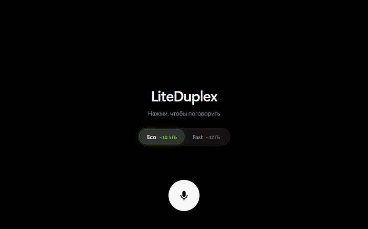
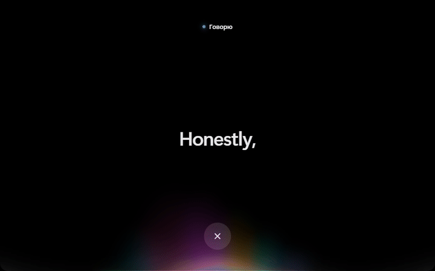
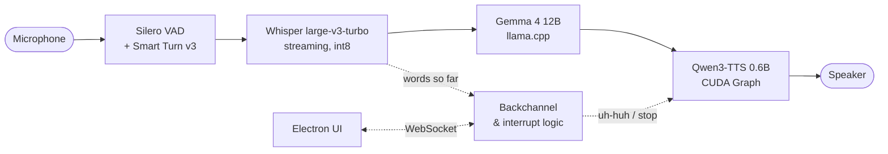

<div align="center">

# LiteDuplex

**A local, full-duplex voice companion that runs on a single consumer GPU.**

You talk, it listens, nods along and answers in a live voice, and you can cut in at any moment, the way you would with a person.
No cloud and no API keys. Everything runs on your machine.



</div>

---

## Highlights

- **Full duplex.** The bot stops as soon as you talk over it with two or more words, or say a stop word such as "stop" or "wait". A short "uh-huh" while it is speaking does not count as an interruption.
- **Backchannels and fillers.** While you are talking, the bot reacts with short clips: neutral, surprised, sympathetic or laughing. The LLM picks the kind from what you just said. After a long turn it may say "hmm" while it thinks.
- **Smart turn-taking.** Silero VAD hears speech, and Smart Turn v3 decides whether you have actually finished. The bot does not jump in during a mid-sentence pause.
- **Streaming speech recognition.** Whisper transcribes while you speak, so the answer starts quickly.
- **Voice mood.** Your loudness, pitch and pace become a hint for the model, for example `[voice: quiet, slow]`.
- **Expressive TTS.** An exclamation mark makes the reply a little faster and higher, an ellipsis slower and lower.
- **Eco and Fast modes.** One switch in the window trades a little VRAM headroom for speed. See [VRAM modes](#vram-modes).
- **A UI that feels alive.** A WebGL distortion wave opens the call, and words fade in from blur as the bot says them.

<div align="center">

</div>

## How it works



| Part | Model | Runs on | Notes |
|---|---|---|---|
| Speech recognition | [Whisper large-v3-turbo](https://huggingface.co/deepdml/faster-whisper-large-v3-turbo-ct2) (CTranslate2) | GPU, `int8_float16` | Greedy decoding, no temperature fallback |
| Language model | [Gemma 4 12B it, QAT Q4_0](https://huggingface.co/google/gemma-4-12B-it-qat-q4_0-gguf) | [llama.cpp](https://github.com/ggml-org/llama.cpp) server | Two slots: the conversation and quick side questions don't evict each other's cache |
| Speech synthesis | [Qwen3-TTS 12Hz 0.6B CustomVoice](https://huggingface.co/Qwen/Qwen3-TTS-12Hz-0.6B-CustomVoice) | GPU, bf16 | Custom decoder loop: static KV cache and one CUDA Graph per frame. RTF ≈ 0.36, first audio in ≈ 170 ms |
| Turn detection | Silero VAD + Smart Turn v3 | CPU | Via [Pipecat](https://github.com/pipecat-ai/pipecat) |

The stock Qwen3-TTS `generate` runs at RTF ≈ 2.6 on Windows. [`fast_tts.py`](fast_tts.py) reimplements the talker and code-predictor loop with a preallocated KV cache, captures one decoding step as a CUDA Graph, and streams audio in 4-frame chunks (0.33 s). That makes it about 7× faster than real time.

## VRAM modes

Pick a mode with the pill under the title. The choice is saved to `config.json`, and the backend restarts with the new settings.

| | **Eco** (default) | **Fast** |
|---|---|---|
| LLM KV cache | 8-bit (`q8_0`) | f16 |
| LLM batch | 256 | 512 |
| TTS text-embedding table (≈ 600 MB) | in system RAM, used once per phrase | on the GPU |
| TTS static cache | 512 frames (≈ 40 s of speech per phrase) | 2048 frames |
| Peak VRAM, whole app | **≈ 10.5 GB** | ≈ 12 GB |
| Speed | same generation and TTS speed, prompt processing ~7% slower | baseline |

Measured on an RTX 5060 Ti 16 GB during an end-to-end dialog test: Whisper, LLM and TTS all loaded and talking.

## Requirements

- **Windows 10 or 11.** The launch scripts, the llama.cpp build and process handling are Windows-specific.
- **NVIDIA GPU** with 12 GB of VRAM for Eco (16 GB recommended), and a recent driver. RTX 30, 40 and 50 series work. PyTorch is installed for CUDA 12.8, which the RTX 50 series (Blackwell) needs.
- **Python 3.10–3.12**, available through the `py` launcher.
- **Node.js 20+** for the window.
- About **25 GB** of free disk space for the models and two virtual environments.

Everything is installed inside the project folder: virtual environments, pip, Hugging Face and CUDA caches, and Electron. Nothing is written to your user profile or drive C:.

## Quick start

```bat
git clone https://github.com/Demosand/LiteDuplex
cd LiteDuplex
LiteDuplex.bat
```

The first run takes a while. It creates `.venv` and `.venv_tts`, installs PyTorch, Pipecat and Qwen3-TTS, downloads the models (about 10 GB) and a llama.cpp CUDA build, then opens the window. Later starts only load the models.

Click the microphone and start talking. Click × to hang up.

There is also a console mode without the window: run `start.bat`.

## Configuration

`config.json` is created on the first run from `DEFAULT_CONFIG` in [`app.py`](app.py). The most useful keys:

| Key | Default | What it does |
|---|---|---|
| `system_prompt` | a casual, ironic friend | The bot's character. Keep the short example lines: small models copy tone from examples better than they follow rules |
| `vram_mode` | `"eco"` | `"eco"` or `"fast"`. The switch in the window sets it too |
| `llm_gguf` / `llm_gguf_repo` | Gemma 4 12B QAT | Any chat GGUF works. If the file is missing, it is downloaded from the repo on start. For a smaller GPU, `unsloth/Qwen3-4B-Instruct-2507-GGUF` needs about 4 GB less, but it is noticeably less smart |
| `tts_speaker` / `tts_language` | first voice / `russian` | The list of voices is printed on start |
| `interrupt_min_words` | `2` | How many words of yours stop the bot mid-sentence |
| `backchannel`, `backchannel_prob`, `backchannel_clips` | on, 0.5 | Reactions while you speak, with words per reaction kind |
| `filler`, `filler_words` | on | A short "hmm" before a reply to a long turn |
| `turn_max_silence` | `2.0` | The bot answers after this much silence, even if Smart Turn is unsure |

> **Language.** The pipeline is currently tuned for **Russian**: Whisper's language, the backchannel words and the UI strings. Gemma 4 and Qwen3-TTS speak many languages. Qwen3-TTS covers English, Chinese, Japanese, Korean, German, French, Russian, Spanish, Portuguese and Italian. To switch, change `Language.RU` in `app.py`, `tts_language`, `backchannel_clips` and `filler_words`.

## Project layout

```
app.py            installer + launcher, TTS server, llama.cpp launch, Pipecat pipeline
duplex.py         streaming Whisper, smart interrupts, backchannels, TTS client, UI bridge
fast_tts.py       Qwen3-TTS decoder loop with a static KV cache and CUDA Graphs
ui/               Electron + React window: mode switch, distortion wave, live captions
tools/            benchmarks, an end-to-end dialog test, a mock backend, GIF recorder
```

Useful tools:

- `tools/e2e_test.py` plays a scripted conversation into the pipeline, with no microphone needed. The llama.cpp and TTS servers must be running.
- `tools/mock_ui_backend.py` is a fake backend for working on the UI without models.
- `tools/record/` re-records the GIFs above (`record.cjs`, then `make_gifs.sh`).

## Credits

- Distortion wave shader and wavefront model: [Libraries.dev](https://libraries.dev) by Jakub Antalik, MIT. See [`ui/src/waves/LICENSE`](ui/src/waves/LICENSE).
- [Pipecat](https://github.com/pipecat-ai/pipecat), [llama.cpp](https://github.com/ggml-org/llama.cpp), [faster-whisper](https://github.com/SYSTRAN/faster-whisper), [Qwen3-TTS](https://github.com/QwenLM/Qwen3-TTS), [Gemma 4](https://huggingface.co/google/gemma-4-12B-it).

Model weights are not part of this repository. They are downloaded from Hugging Face under their own licenses: Gemma 4 and Qwen3-TTS under Apache 2.0, Whisper under MIT.

## License

[MIT](LICENSE)
